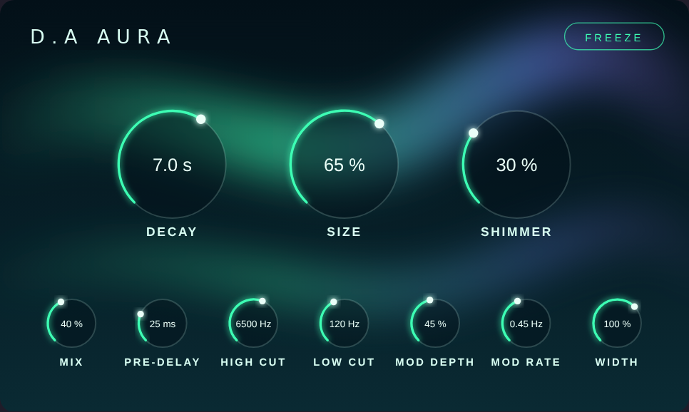

# D.A AURA

A lush, shimmering, modulated reverb plugin built with JUCE 8.

* **Windows 64-bit:** VST3
* **macOS (Universal: Apple Silicon + Intel):** AU and VST3

## Interface

"Aurora" design (see `Design/aurora-design.png`). The window is resizable: drag the bottom-right
corner (480 px to 1800 px wide, fixed aspect ratio). The size is saved with the project.
Double-click a knob to reset it to its default value.



## Controls

| Knob | What it does |
|---|---|
| Mix | Dry / wet balance (equal power) |
| Size | Room size (0.35x to 2x delay lengths) |
| Decay | Reverb time, 0.3 to 30 s |
| Pre-Delay | Gap before the reverb starts, 0 to 500 ms |
| Shimmer | Octave-up feedback for the angelic halo |
| High Cut | Damping of highs inside the tail |
| Low Cut | Removes mud inside the tail |
| Mod Depth / Mod Rate | Chorus-like movement of the tail |
| Width | Stereo width of the wet signal (0 to 150 %) |
| Freeze | Holds the current tail forever and mutes new input |

## Build with GitHub Actions

1. Create a new repository on GitHub.
2. Upload **everything** in this folder, including the hidden `.github` folder
   (`.github/workflows/build.yml`). The easiest way:

   ```
   git init
   git add .
   git commit -m "D.A AURA"
   git branch -M main
   git remote add origin https://github.com/<you>/<repo>.git
   git push -u origin main
   ```
3. Open the **Actions** tab. The "Build D.A AURA" workflow starts on every push
   (you can also start it by hand with "Run workflow").
4. When it finishes, download the artifacts at the bottom of the run page:
   * `DA-AURA-Windows-x64-Installer`
   * `DA-AURA-macOS-Installer`

JUCE is downloaded automatically by CMake, nothing else is needed.

## Install

**Windows:** extract `D.A AURA Installer.exe` from the downloaded Actions artifact
and run it. The EXE contains the complete VST3 bundle: it can be copied to the desktop or
sent on its own, without the ZIP or a separate plugins folder. Click Next and confirm to
install to `C:\Program Files\Common Files\VST3\D.A AURA.vst3`. Windows asks for
administrator permission. The installer is not code-signed, so Windows SmartScreen may
show a warning. Restart or rescan the DAW after installation.

The welcome artwork retains the D.A Production branding from the supplied reference.
The installer installs D.A AURA, and the artwork scales to fit smaller screens while
keeping the reference aspect ratio.

If an older `D.A Dreamy Reverb.vst3` bundle is installed, remove it after installing
AURA to avoid duplicate plugin entries. The internal plugin IDs have been retained for
compatibility, but existing DAW projects should be backed up and tested after the rename.

**macOS:** open `DA-AURA-macOS-Installer.dmg` and run `D.A AURA Installer.app`.
The app contains both AU and VST3 bundles and can be copied out of the DMG and run on
its own. It installs them for the current user under `~/Library/Audio/Plug-Ins/`.
The installer requires macOS 11 or newer (Intel or Apple Silicon). It is ad-hoc signed,
not notarized, so macOS Gatekeeper may warn or prevent it from opening. If you trust it,
use the standard macOS Privacy & Security controls to allow it. The plug-ins themselves
are also ad-hoc signed, so DAW acceptance may vary.

Then restart your DAW (Logic may need a rescan or a reboot to pick up the new AU).

## Build locally

```
cmake -B build -DCMAKE_BUILD_TYPE=Release
cmake --build build --config Release
```

Results are in `build/DreamyReverb_artefacts/Release/`.

## Layout

```
CMakeLists.txt                 build setup (fetches JUCE 8.0.4)
Source/DreamyReverbDSP.h       the reverb algorithm (plain C++)
Source/PluginProcessor.*       parameters, state, audio callback
Source/PluginEditor.*          user interface
Design/aurora-design.png       the approved look of the plugin
Installer/                     self-contained Windows installer and reference artwork
.github/workflows/build.yml    CI for Windows and macOS
```

Note: JUCE is dual licensed (AGPLv3 or commercial). Check the JUCE licence before selling the plugin.
