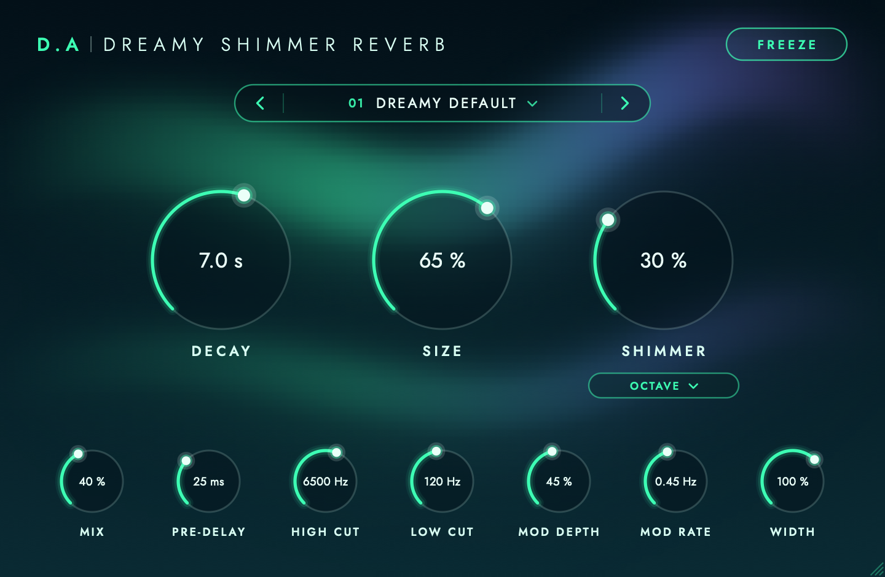

# D.A Dreamy Shimmer Reverb

A lush shimmer reverb plugin built with JUCE 8: a modulated reverb whose tail climbs up in octaves.

* **Windows 64-bit:** VST3
* **macOS (Universal: Apple Silicon + Intel):** AU and VST3



## Interface

"Aurora" design, set in the Jost typeface. The window is resizable: drag the bottom-right corner
(480 px to 1800 px wide, fixed aspect ratio). The size is saved with the project.
Double-click a knob to reset it to its default value.

### Presets

The bar below the title steps through the 50 factory presets:

* **`<` and `>`** load the previous / next preset (the list wraps around).
* **Click the name** to open the full list, sorted by category.
* A `*` after the name means a knob was changed since the preset was loaded.

Loading a preset starts with an empty reverb (10 ms fade), so the old tail never bends in pitch.
The preset number is saved with the project.

| Category | Presets |
|---|---|
| Signature | 01 Dreamy Default, 02 Angel Halo, 03 Crystal Cathedral, 04 Velvet Sky, 05 Aurora Borealis, 06 Glass Choir, 07 Deep Heaven, 08 Silk Shimmer |
| Vocals | 09 Vocal Halo, 10 Lead Vocal Air, 11 Dream Pop Vocal, 12 Whisper Cloud, 13 Choir Lift, 14 Backing Vox Wash, 15 Ballad Plate Glow, 16 Ethereal Ad-Libs |
| Guitars | 17 Ambient Guitar Swell, 18 Post-Rock Skyline, 19 Clean Strat Shine, 20 Edge Of Heaven, 21 Acoustic Glow, 22 Shoegaze Wall, 23 Slide Mirage |
| Keys & Synths | 24 Felt Piano Dream, 25 Grand Piano Halo, 26 Rhodes Stardust, 27 Pad Expander, 28 Synth Bloom, 29 Pluck Sparkle, 30 Organ Vault, 31 Music Box Frost |
| Cinematic | 32 Neon Dawn, 33 Event Horizon, 34 Cathedral Of Ice, 35 Slow Sunrise, 36 Underwater Temple, 37 Starfield, 38 Last Light |
| Ambient | 39 Infinite Horizon, 40 Cloud Bank, 41 Deep Space Drone, 42 Tape Heaven, 43 Ocean Of Glass, 44 Sleep Cycle |
| Special | 45 Dark Matter, 46 Fifth Dimension, 47 Shimmer Slap, 48 Small Room Sparkle, 49 Pure Hall (No Shimmer), 50 Pure Plate (No Shimmer) |

## Controls

| Control | What it does |
|---|---|
| Decay | Reverb time, 0.3 to 30 s |
| Size | Room size (0.35x to 2x delay lengths) |
| Shimmer | How much of the tail is pitched up and fed back, 0 to 100 % |
| Interval (below Shimmer) | Octave, Octave + 5th, 2 Octaves or Sub + Octave |
| Mix | Dry / wet balance (equal power) |
| Pre-Delay | Gap before the reverb starts, 0 to 500 ms |
| High Cut | Damping of highs inside the tail |
| Low Cut | Removes mud inside the tail (12 dB / octave) |
| Mod Depth / Mod Rate | Chorus-like movement of the tail |
| Width | Stereo width of the wet signal (0 to 150 %) |
| Freeze | Holds the current tail and mutes new input |

## The shimmer engine

* **De-glitched pitch voices.** Each voice plays four overlapping grains, and every new grain is
  lined up with the one before it (cross-correlation search). Notes and chords come out as steady,
  clean octaves instead of a grainy flutter.
* **No aliasing.** The signal is band-limited before it is pitched up, and read back with cubic
  interpolation.
* **Level that follows the decay.** The Shimmer knob sets the gain of the pitch loop directly, so
  it sounds the same at 1 s and at 30 s decay and can never run away.
* **Wide stereo.** Left and right are tuned 1.5 cents apart in opposite directions and cross-fed.
* **Click-free.** Interval changes are picked up grain by grain; Freeze fades in and out.

## Download a build (GitHub Actions)

Every push builds the plugin on Windows and macOS. Open the **Actions** tab, click the newest
"Build D.A Dreamy Shimmer Reverb" run and download the artifacts at the bottom of the page:

* `DreamyShimmerReverb-Windows-x64-VST3` - the VST3 folder and `INSTALL.txt`
* `DreamyShimmerReverb-macOS-AU-VST3` - an installer package, `Manual-Install.zip` and `INSTALL.txt`

The workflow also runs the self tests in `Tests/`, validates the VST3 with pluginval on both
systems, installs the macOS package and validates the installed AU with Apple's `auval`.

## Install

`INSTALL.txt` inside each download has the full steps (English and Persian). In short:

**Windows:** copy the folder `D.A Dreamy Shimmer Reverb.vst3` to `C:\Program Files\Common Files\VST3\`
and rescan plugins in the DAW.

**macOS:** right-click `D.A Dreamy Shimmer Reverb Installer.pkg` and choose *Open*
(macOS 15+: double-click, then *System Settings > Privacy & Security > Open Anyway*).
It installs the AU and the VST3 into `/Library/Audio/Plug-Ins/`. The build is ad-hoc signed and not
notarized, which is why macOS asks once. Files installed by the package are not quarantined.

For a manual install on macOS, copy the bundles from `Manual-Install.zip` to
`~/Library/Audio/Plug-Ins/Components/` and `~/Library/Audio/Plug-Ins/VST3/` and remove the quarantine
flag, otherwise macOS blocks the plugin in every DAW:

```
xattr -cr ~/Library/Audio/Plug-Ins/Components/"D.A Dreamy Shimmer Reverb.component"
xattr -cr ~/Library/Audio/Plug-Ins/VST3/"D.A Dreamy Shimmer Reverb.vst3"
```

### Version 1.0 ("D.A Dreamy Reverb")

D.A Dreamy Shimmer Reverb is a separate plugin with its own ID (AU `aufx Dshr Drma`). The old
"D.A Dreamy Reverb" can stay installed: both show up in the DAW and old projects keep using the old
plugin. (Build 1.1 of this plugin still used the ID of version 1.0. With both installed, hosts
loaded only one of the two - delete build 1.1 if you installed it.)

## Build locally

```
cmake -B build -DCMAKE_BUILD_TYPE=Release
cmake --build build --config Release
```

Results are in `build/DreamyReverb_artefacts/Release/`. JUCE is downloaded automatically by CMake.

Add `-DDREAMY_BUILD_TESTS=ON` to also build the two self tests:

* `DreamyDspTest` checks the reverb algorithm (stability, decay, shimmer, freeze, all presets).
* `DreamyPluginTest` checks the whole plugin without a host (parameters, presets, state,
  channel layouts, editor) and can save screenshots: `DreamyPluginTest snapshots`.

## Layout

```
CMakeLists.txt                 build setup (fetches JUCE 8.0.4)
Source/DreamyReverbDSP.h       the reverb and shimmer algorithm (plain C++)
Source/Presets.h               the 50 factory presets
Source/PluginProcessor.*       parameters, presets, state, audio callback
Source/PluginEditor.*          user interface
Assets/Fonts/                  Jost typeface (SIL Open Font License, see OFL.txt)
Packaging/                     install notes that ship with the downloads
Tests/                         self tests
Design/screenshot.png          screenshot of the plugin (rendered by the CI self test)
.github/workflows/build.yml    CI for Windows and macOS
```

## Licences

* JUCE is dual licensed (AGPLv3 or commercial). Check the JUCE licence before selling the plugin.
* The Jost typeface is licensed under the SIL Open Font License 1.1 (`Assets/Fonts/OFL.txt`),
  which allows embedding it in commercial software.
