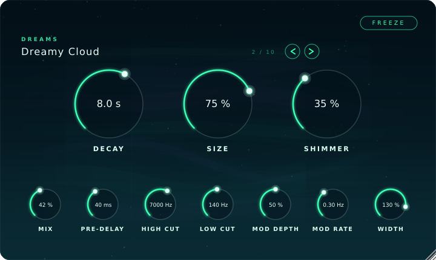
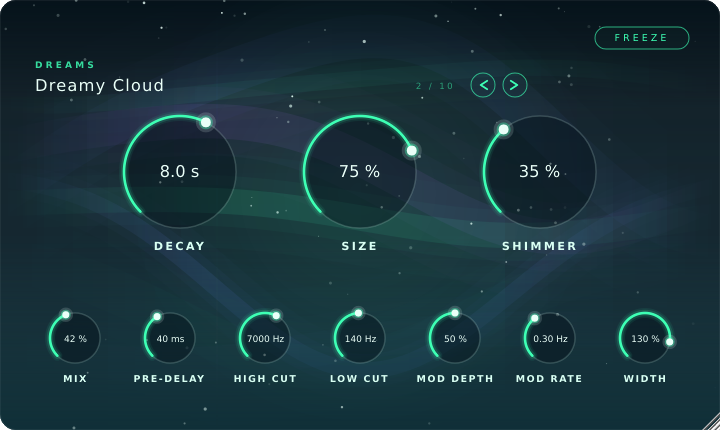

# D.A AURA

A lush, shimmering, modulated reverb plug-in by **D.A Production**, built with JUCE 9.0.5.

* **Windows 64-bit:** VST3 (`D.A AURA.vst3`) + `D.A AURA Installer.exe`
* **macOS Universal (Apple Silicon + Intel):** AU (`D.A AURA.component`) and VST3 (`D.A AURA.vst3`) + `D.A AURA Installer.app`

## Interface

"Aurora" design (see `Design/aurora-design.png`). The window is resizable: drag the bottom-right
corner (480 px to 1800 px wide, fixed aspect ratio). The size is saved with the project.
Double-click a knob to reset it to its default value.


The aurora behind the knobs is alive: it is still at rest, and with a signal it moves with it —
the ribbons swell and travel with the wet level, the stars brighten from left (low) to
right (high) with the signal's spectrum, and every onset sends a ring of light outward from
the middle. The motion comes from what the plug-in is playing, not from a timer of its own.

| at rest | with a signal |
|---|---|
|  |  |

## Presets

Fifty factory presets, in five spaces:

| Space | What it is for |
|---|---|
| **Rooms** | everyday rooms, from a small room to an empty arena |
| **Plates** | bright, dark, vintage, vocal and drum plates |
| **Spaces** | cathedral, church, cave, tunnel, canyon, cistern, and other architecture |
| **Dreams** | shimmer and slow motion: dreamy cloud, halo pad, aurora borealis, weightless |
| **Extremes** | black hole, deep space, time warp, ghost ship, endless rise, and two frozen ones |

The window shows the space, the preset's name and how far through the space it is, with two
arrows that step back and forward through that space (wrapping around inside it). The same fifty
presets are the plug-in's programs, so the host's own preset menu lists them too.

## Controls

| Knob | What it does |
|---|---|
| Mix | Dry / wet balance (equal power) |
| Size | Room size (0.35x to 2x delay lengths) |
| Decay | Reverb time, 0.3 to 30 s |
| Pre-Delay | Gap before the reverb starts, 0 to 500 ms |
| Shimmer | Octave-up feedback for the angelic halo |
| High Cut | Damping of highs inside the tail |
| Low Cut | Removes mud inside the tail |
| Mod Depth / Mod Rate | Chorus-like movement of the tail |
| Width | Stereo width of the wet signal (0 to 150 %) |
| Freeze | Holds the current tail forever and mutes new input |

## Download

The files to download are on the **[latest release](https://github.com/drdrillcontact-create/D.A-DreamyReverb/releases/latest)**
— nothing to build, and no GitHub account needed:

| File | For | Holds |
| - | - | - |
| `D.A-AURA-Windows-Installer.zip` | Windows 64-bit | `D.A AURA Installer.exe` |
| `D.A-AURA-Windows-x64-VST3.zip` | Windows 64-bit | `D.A AURA.vst3` |
| `D.A-AURA-macOS-Installer.zip` | macOS, Apple Silicon and Intel | `D.A AURA Installer.app` |
| `D.A-AURA-macOS-Universal-AU-VST3.zip` | macOS, Apple Silicon and Intel | `D.A AURA.component` + `D.A AURA.vst3` |

(A release is made by every build on the main branch, and by a manual run of the workflow with
**publish** ticked; its files are replaced by the newest build of the same version, so the link
above stays the same.)

## Build with GitHub Actions

1. Push to GitHub; the **Build D.A AURA** workflow starts automatically (or run it manually via **Actions -> Build D.A AURA -> Run workflow**).
2. Download the files from the workflow run's artifacts (kept for ninety days), or from the release
   the run makes when it is on the main branch (`v1.0.0` for this version):
   * `D.A-AURA-Windows-Installer.zip` (`D.A AURA Installer.exe`)
   * `D.A-AURA-macOS-Installer.zip` (`D.A AURA Installer.app`)
   * `D.A-AURA-Windows-x64-VST3.zip` (`D.A AURA.vst3`)
   * `D.A-AURA-macOS-Universal-AU-VST3.zip` (`D.A AURA.component` + `D.A AURA.vst3`)

## Install

**Windows:** extract `D.A-AURA-Windows-Installer.zip` and run **`D.A AURA Installer.exe`**. It asks for
administrator privileges, opens the borderless D.A Production installer window (`980 x 386` logical units,
resizable with fixed proportions, octagonal frame), lets you review the VST3 target
(`C:\Program Files\Common Files\VST3`), and installs `D.A AURA.vst3`.

**macOS:** extract `D.A-AURA-macOS-Installer.zip` and open **`D.A AURA Installer.app`**. It opens the
same borderless D.A Production installer window, lets you select **Audio Unit**
(`~/Library/Audio/Plug-Ins/Components`) and/or **VST3** (`~/Library/Audio/Plug-Ins/VST3`), and installs
the Universal (`arm64` + `x86_64`) bundles.

Both installers also support `--silent` (headless installation into the standard folders).

## Reusing this installer for another plug-in

`Docs/INSTALLER_PROMPT_EN.md`, `Docs/INSTALLER_PROMPT_FA.md` (Persian) and
`Docs/INSTALLER_PROMPT_SHORT.md` hold the ready-made prompt to give an agent: hand it the
design picture plus three lines of names, and it ports this installer to another D.A
Production plug-in with the same look, behaviour and CI checks.

## Build locally

```sh
cmake -B build -DCMAKE_BUILD_TYPE=Release
cmake --build build --config Release
```

## Tests

```sh
bash Tests/run-preset-checks.sh     # the fifty presets: spaces, ranges, names, browsing
bash Tests/run-editor-harness.sh    # the presets, the browser's arrows, the aurora answering a signal
bash Tests/syntax-check.sh          # the sources against JUCE, -Wall -Wextra -Werror
bash Tests/run-editor-pictures.sh   # draws the window to pictures, at rest and with a signal
bash Tests/run-installer-harness.sh # the installer's pages, without a display (Linux)
```

The first three run without a plug-in host; the editor harness and the pictures build JUCE
once through `Tests/local-juce.sh`.

Plug-in bundles are written to `build/DAAURA_artefacts/Release/`, and the installer is written to
`build/DAAURAInstaller_artefacts/Release/`.

## Layout

```
CMakeLists.txt                 JUCE 9.0.5 build setup for DAAURA and DAAURAInstaller
Source/AuraDSP.h               the reverb algorithm (plain C++)
Source/PluginProcessor.*       parameters, state, audio callback
Source/PluginEditor.*          plug-in user interface
Design/aurora-design.png       plug-in UI preview
Installer/Design/              master installer design (Installer.png) and asset generator
Installer/Assets/              built-in installer artwork, patches, icon, and Red Hat Display fonts
Installer/Source/              JUCE cross-platform installer (Windows & macOS)
Tests/                         headless Linux JUCE harness for the installer
.github/workflows/build.yml    Windows & macOS CI build, pluginval, auval, and live installer verification
```

Note: JUCE is dual licensed (AGPLv3 or commercial). Check the JUCE licence before selling the plug-in.
